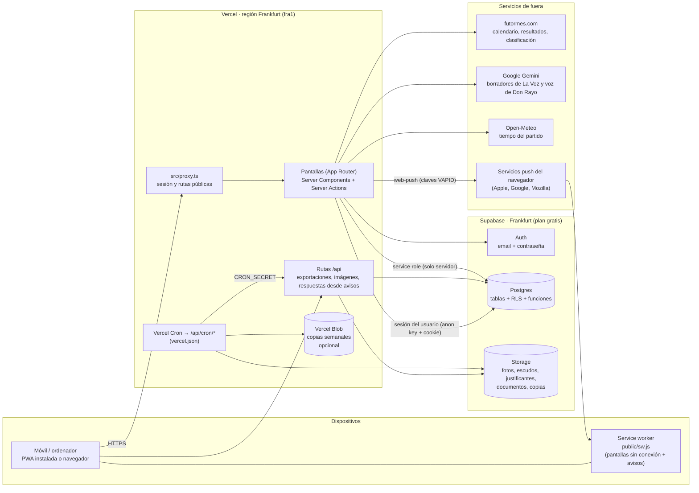

# Arquitectura

> Actualizado en la versión 4.31.6. Si cambias una pieza de las que salen aquí (un servicio nuevo, una tarea automática, otra forma de entrar), actualiza este documento en el mismo PR.

## De un vistazo



## Las piezas

| Pieza | Qué hace | Dónde está |
|---|---|---|
| **Next.js 16 (App Router)** | Pinta las pantallas en el servidor y ejecuta las acciones de los formularios (Server Actions). Casi no hay lógica en el navegador. | `src/app/`, `src/components/` |
| **Proxy** | En cada petición renueva la sesión de Supabase y manda al login a quien no la tiene, salvo en las rutas públicas (`/rifa`, `/noticias`, `/privacidad`, `/reparar`, `/mantenimiento`, `/api/cron`, respuestas desde avisos…). | `src/proxy.ts` |
| **Supabase Auth** | Entrar con email y contraseña. El registro abierto está apagado: solo entra quien da de alta un gestor. | `src/lib/session.ts`, `src/app/login`, `src/app/auth` |
| **Postgres + RLS** | Toda la seguridad está también en la base de datos: cada tabla tiene políticas que preguntan a `has_perm()`. Aunque alguien manipule la app, solo lee y cambia lo que su perfil permite. | `supabase/migrations/` |
| **Funciones SQL (RPC)** | Lo delicado (vender números, cobrar, sortear, votar, dar de baja…) se hace dentro de una función SQL, en una sola transacción. | ver [base-de-datos.md](base-de-datos.md#funciones-sql-críticas) |
| **Storage** | Cajones de archivos. Públicos (se ven con el enlace): `avatars`, `player-photos`, `rival-crests`, `sponsor-logos`, `news-photos`, `news-press` (voz de Don Rayo). Privados (solo con permiso): `finance-docs`, `player-docs`, `sponsor-docs` y `backups` (lo crea la primera copia). | migraciones (`insert into storage.buckets`) |
| **Web Push** | Avisos al móvil. Las claves VAPID se generan solas la primera vez y se guardan en `app_secrets`. | `src/lib/push.ts`, `public/sw.js` |
| **Vercel Cron** | Tareas programadas (abajo). Cada una comprueba la cabecera `Authorization: Bearer CRON_SECRET`; si falta `CRON_SECRET` en el servidor, todas se rechazan (503) en lugar de quedar abiertas (4.32.1). | `vercel.json`, `src/app/api/cron/`, `src/lib/cron.ts` |
| **Copias** | Copia completa cada lunes (tablas + archivos) en Vercel Blob o, si no hay, en el cajón `backups`; se guardan 8. | `src/lib/backup.ts`, ver [recuperacion.md](recuperacion.md) |

### Tres formas de hablar con la base de datos

1. **Con la sesión de la persona** (`src/lib/supabase/server.ts`, clave *anon* + cookie). Es lo normal: manda RLS.
2. **Con la clave de servicio** (`src/lib/supabase/admin.ts`, `SUPABASE_SERVICE_ROLE_KEY`). Se salta RLS, así que solo se usa en el servidor y para cosas concretas: dar de alta usuarios, mandar avisos, tareas automáticas, copias, respuestas desde los botones de los avisos y el registro de accesos.
3. **Sin sesión** (clave *anon*). Solo para lo público: la página de la rifa (`raffle_public`, `raffle_public_check`), las noticias públicas (`news_public*`) y el estado de mantenimiento (`app_public_status`).

### Responder desde el aviso sin iniciar sesión

Los botones «Voy / No voy» de una convocatoria y «Sí / No» de una votación llevan un **token firmado** (HMAC con una clave guardada en `app_secrets`). La ruta `/api/convocatoria/responder` o `/api/votacion/responder` comprueba el token y responde en nombre de esa persona con la clave de servicio. Código: `src/lib/signed-token.ts`.

## Tareas automáticas (`vercel.json`)

Las horas de Vercel Cron van en **UTC** (en invierno, una hora menos que en Madrid).

| Ruta | Cuándo (UTC) | Qué hace |
|---|---|---|
| `/api/cron/convocatorias` | todos los días 08:00 | Recordatorio a quien no ha respondido a la convocatoria, plazos de patrocinio que vencen y cumpleaños |
| `/api/cron/liga` | lunes 07:00 | Comprueba que la web de la liga se sigue leyendo bien (no guarda nada) |
| `/api/cron/fichajes` | todos los días 09:00 | Avisa si hay jugadores nuevos del Rayo en futormes |
| `/api/cron/resultado?vuelta=1…5` | 13:00, 16:00, 19:00, 21:30 y 07:00 | El día del partido, busca el resultado en futormes y avisa «Ya están los datos del partido» |
| `/api/cron/mvp` | todos los días 23:15 | Cierra la votación del MVP y las notas |
| `/api/cron/capsula` | todos los días 23:40 | Avisa cuando se abre la cápsula del tiempo y recuerda escribir antes de que se cierre |
| `/api/cron/copia` | lunes 03:00 | Copia de seguridad completa |

## Cómo viaja un cambio

1. Rama `claude/…` → PR. GitHub Actions (`.github/workflows/tests.yml`) pasa las pruebas de lógica, tipos, lint, las pruebas contra un Supabase local y la prueba de humo.
2. Si el PR trae una migración nueva, se ejecuta **antes** a mano en el *SQL Editor* de producción y se apunta en [cambios-base-de-datos.md](cambios-base-de-datos.md).
3. Al fusionar en `main`, Vercel despliega solo. La app avisa a cada móvil de que hay versión nueva (*Novedades*).

## Estructura del código

```
supabase/migrations/   Esquema, RLS, funciones y auditoría (una migración por versión con SQL)
supabase/seed.sql      Datos de ejemplo para el Supabase local (nunca llegan a producción)
src/proxy.ts           Sesión y rutas públicas
src/app/(app)/         Pantallas con sesión: (inicio), partidos, plantilla, loteria, mis-ventas, finanzas,
                       la-voz, votaciones, perfil, novedades, admin (Gestión: usuarios, perfiles, avisos,
                       material, auditoria, uso, copia, mandos)
src/app/login, auth/   Entrar, salir, invitaciones y recuperar contraseña
src/app/rifa/          Página pública de las rifas
src/app/noticias/      Noticias públicas de La Voz del Rayo
src/app/mantenimiento, reparar/   Pantalla de obras y reparación de la app en el móvil
src/app/api/           Exportaciones, imágenes, copia, respuestas desde avisos y tareas automáticas
src/lib/               Lógica de cada módulo (pura y con pruebas en __tests__), consultas (*-queries.ts),
                       liga (league-*.ts), avisos (push*.ts), sesión y permisos
src/components/        Componentes de pantalla compartidos
tests/db/              Pruebas contra el Supabase local
e2e/                   Prueba de humo de la app entera (Playwright)
scripts/               Datos simulados de futormes y restauración de copias
public/                Escudo, iconos de la PWA, logos y service worker
docs/                  Esta documentación
```
