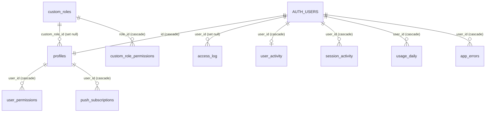
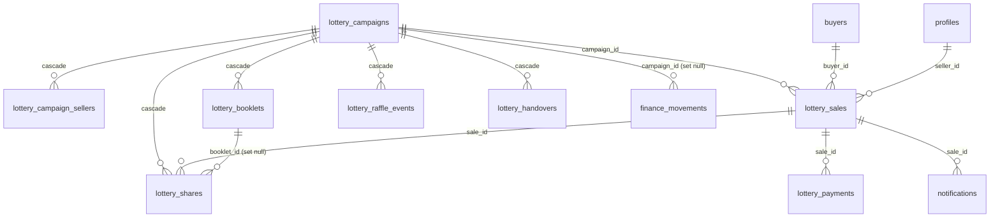
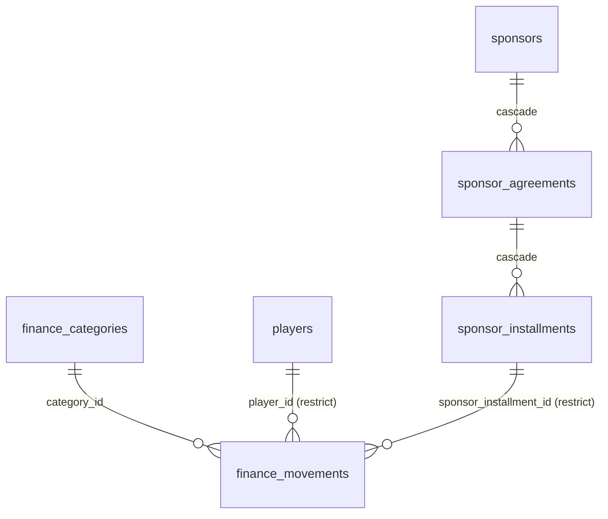
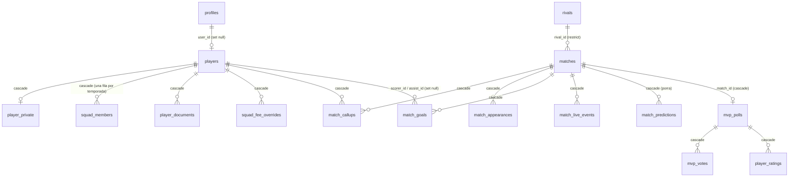
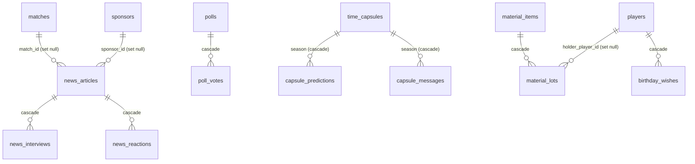

# Base de datos

> Actualizado en la versión 4.31.6 (62 tablas en `public`, 168 políticas RLS, 56 migraciones). El esquema completo es la suma de `supabase/migrations/` en orden; este documento explica **cómo encajan las piezas** y qué funciones no se pueden tocar a la ligera. Los cambios de cada versión están en [cambios-base-de-datos.md](cambios-base-de-datos.md).

Para mirar el esquema real: `npx supabase start` y abre Studio (<http://127.0.0.1:54323>), o en producción *Database → Tables* del panel de Supabase.

## Ideas que lo atraviesan todo

- **Usuarios y jugadores son cosas distintas.** `profiles` es quien entra en la app (uno por usuario de `auth.users`). `players` es la ficha deportiva. Se enlazan con `players.user_id`, que puede estar vacío (un jugador sin acceso a la app) o apuntar a un perfil.
- **Temporadas como texto** `'2026/27'` (septiembre–agosto). En `matches` y `finance_movements` la columna `season` se **calcula sola** a partir de la fecha (columna *generated*): no se escribe nunca.
- **Dinero en céntimos** (`integer`, columnas `*_cents`) para no tener redondeos.
- **Permisos**: `role_permissions` (por perfil base) → `custom_role_permissions` (perfiles a medida) → `user_permissions` (excepciones por persona). La función `user_has_perm()` decide, con reglas fijas del club: el superadministrador puede todo; Auditoría solo él; Finanzas, Patrocinadores y datos personales nunca para jugadores.
- **Nada se borra a escondidas.** Ventas, cobros y movimientos de Finanzas no se borran: se anulan con motivo (hay disparadores que lo impiden). Casi todas las tablas tienen el disparador `audit_*` que apunta en `audit_log` el valor anterior y el nuevo.
- **Borrados en cascada pensados**: al borrar un partido se van su convocatoria, acta, goles, porra y directo; al borrar un jugador, sus temporadas, documentos y datos personales. Lo que tiene dinero detrás usa `restrict` (no se puede borrar un jugador con movimientos en Finanzas ni un plazo de patrocinio ya cobrado).

## Relaciones principales

Las flechas van de la tabla que apunta a la tabla apuntada. «cascade» = al borrar la de arriba se borra esta; «set null» = se queda sin enlace; «restrict» = no deja borrar.

### Usuarios y permisos

- `role_permissions` no apunta a nadie: clave `(role, module)` con `can_read/create/update/delete`.
- `app_settings` (una sola fila) guarda los *Mandos*: mantenimiento, mensaje fijo, apartados apagados, «forzar actualización».
- `app_secrets` guarda las claves del servidor (VAPID de los avisos, firma de los tokens). **No entra en las copias.**

### Sorteos (lotería y rifas)

- `lottery_shares` son los números (rifa) o participaciones (lotería). Se crean solos al crear la campaña y pasan por `available → reserved/sold → voided`.
- `lottery_raffle_events` es el acta pública: cierre de ventas con su huella (`raffle_fingerprint`), reaperturas y sorteo.
- `lottery_handovers`: lo que cada vendedor entrega al club de lo que cobró.

### Finanzas y patrocinadores

- `finance_movements` es el libro de cuentas. Llegan solos: cuotas (`player_id`), sorteos (`campaign_id`) y plazos de patrocinio (`sponsor_installment_id`). Anulado = `voided_at` + `voided_by` + motivo.
- `finance_settings` (saldo inicial) y `sponsor_settings` (interruptores de logos) son de una fila.

### Plantilla, partidos y lo que cuelga de ellos

- `squad_members` es «el jugador en una temporada»: dorsal, posición, estado y estadísticas de liga (`league_stats_by` por competición).
- `squad_fee_plans` (cuota de cada temporada) no apunta a nadie; `squad_fee_overrides` son las cuotas especiales por jugador.
- `league_competitions` y `league_sync` guardan qué competiciones de futormes se siguen y la última sincronización. `matches.league_competition` dice a qué liga pertenece cada partido (Apertura, Clausura…).
- `season_goals`: objetivos de la temporada.

### La Voz del Rayo, votaciones, cápsula y material

- `capsule_predictions` y `capsule_messages` están **bajo llave** hasta que se abre la cápsula: ni RLS ni la copia de seguridad las enseñan antes.
- `push_log` registra cada aviso enviado; `audit_log` es la auditoría (solo inserta el disparador, nadie la edita).

## Funciones SQL críticas

Casi todas son `security definer`: corren con permisos de dueño, así que **comprueban los permisos por dentro** (con `has_perm()` o `auth.uid()`). Si cambias una, mantén esas comprobaciones y añade o ajusta su prueba en `tests/db/`. Para ver la versión vigente de una función, busca la **última** migración que la define (`grep -l "function public.NOMBRE(" supabase/migrations/*.sql | tail -1`).

### Seguridad y sesión

| Función | Qué hace | Ojo |
|---|---|---|
| `user_has_perm(user, módulo, acción)` / `has_perm(módulo, acción)` | El corazón de RLS: decide si alguien puede leer/crear/editar/borrar en un módulo. `has_perm` es la misma con `auth.uid()`. | Las políticas la llaman como `(select has_perm(...))` para que se evalúe una vez por consulta (4.21.1, 34 ms → 2 ms). Mantén el `select`. |
| `is_superadmin()`, `current_role_name()`, `my_permissions()` | Atajos de lo anterior para la app. | |
| `handle_new_user()` (disparador de `auth.users`) | Crea el perfil al dar de alta un usuario. **El primer usuario de un proyecto vacío es superadministrador.** | Importa al restaurar una copia: ver [recuperacion.md](recuperacion.md). |
| `guard_profile_update()` (disparador `profiles_guard`) | Impide cambiar roles, activar/desactivar o nombrar superadministradores sin permiso. | |
| `session_alive()` | En cada pantalla: ¿sigue abierta mi sesión? y apunta la última conexión. | Es lo que hace efectivo «cerrar sesión» al momento. |
| `admin_sessions()`, `admin_close_session()`, `admin_close_all_sessions()` | Ver y cerrar sesiones abiertas (solo superadministrador). | |
| `remove_member(uid)` | Da de baja a un usuario borrando sus datos personales; queda «Antiguo miembro» para que cuadren ventas y cuentas. | Irreversible. |
| `app_public_status()` | Estado de mantenimiento para las páginas sin sesión. | Única función, junto a las públicas de abajo, que puede llamar `anon`. |

### Sorteos

| Función | Qué hace | Ojo |
|---|---|---|
| `lottery_register_sale(...)` | Registra una venta: comprador, números (automáticos, de talonario o elegidos), cobro inicial y referencia. | Bloquea la campaña y los números (`for update … skip locked`) y la referencia con `pg_advisory_xact_lock`: **es lo que evita números repetidos** cuando venden muchos a la vez. |
| `lottery_add_payment`, `lottery_recalc_payment` | Cobros parciales o totales; recalcula el estado de pago de la venta. | Los cobros no se editan ni borran (`lottery_payments_immutable`). |
| `lottery_cancel_sale(venta, motivo, liberar)` | Anula una venta: los números vuelven a estar libres o quedan anulados. | Las ventas no se borran (`lottery_sales_no_delete`). |
| `lottery_draw_winner(campaña, número)` | Sortea una rifa. Exige las ventas **cerradas** antes (4.30.6). | El cierre guarda la huella en el acta pública. |
| `raffle_fingerprint(números)` | Huella SHA-256 de los números vendidos al cerrar. | Si cambia, las huellas antiguas dejan de cuadrar: **no tocar**. |
| `raffle_public`, `raffle_public_check` | Página pública de la rifa y «comprueba tu número». | Públicas (`anon`): no deben devolver nombres ni teléfonos. |
| `lottery_campaign_summary`, `lottery_seller_ranking`, `lottery_seller_accounts` | Resúmenes, ranking y cuentas de cada vendedor. | |
| `lottery_update_booklet`, `lottery_delete_booklet` | Corregir o quitar talonarios sin dejar fuera números vendidos. | |
| `lottery_delete_campaign(campaña, nombre)` | Borra una campaña entera (solo superadministrador; pide escribir el nombre). | Irreversible. |

### Finanzas

| Función | Qué hace | Ojo |
|---|---|---|
| `finance_void_movement(id, motivo)` | Anula un movimiento (nunca se borra). | |
| `finance_import_campaign(campaña)` | Pasa a Finanzas lo cobrado en un sorteo; solo la diferencia con lo ya pasado. | Se puede pulsar varias veces sin duplicar. |
| `finance_summary(desde, hasta)`, `finance_seasons()`, `finance_season(fecha)` | Saldo e informes; temporada de una fecha. | `finance_season` es la regla septiembre–agosto que usan las columnas `season`. |

### Partidos y votaciones

| Función | Qué hace | Ojo |
|---|---|---|
| `callup_reply(partido, respuesta, nota)` | El jugador responde a **su** convocatoria. | La respuesta desde el aviso del móvil pasa por el servidor con un token firmado. |
| `mvp_open`, `mvp_vote`, `mvp_finish`, `mvp_pick`, `mvp_board` | Votación del MVP: abrir, votar (secreto), cerrar con desempate (votos → nota → goles → gestor), elegir a mano. | `mvp_finish` lo llama el cron de las 23:15. |
| `rating_set`, `rating_board`, `rating_season` | Notas 1–10 de cada partido y medias. | Solo se ve la nota del podio al cerrar. |
| `poll_cast` (interna), `poll_vote`, `poll_board`, `poll_for_me` | Votaciones sí/no. `poll_cast` hace las comprobaciones; la usan la app y el botón del aviso. | `poll_cast` no la puede llamar la app directamente. |
| `porra_save`, `porra_open` | Porra del partido; se cierra al pitido. | |
| `squad_season_stats(temporada)` | Estadísticas de la temporada calculadas de las actas. | |

### Auditoría y registros

| Función | Qué hace |
|---|---|
| `audit_trigger()` | Disparador de casi todas las tablas: guarda en `audit_log` quién, cuándo y qué tabla. En un alta o un borrado, la fila sin campos vacíos; en una modificación, solo los campos que cambian (lista en `changed`) más los que identifican el registro (`audit_identity_keys()`). Los datos de `player_private` se guardan como «(dato privado)» y los textos de más de 500 caracteres, recortados (4.32.2). |
| `purge_audit_log(meses)` | Borra de `audit_log` y `access_log` lo de hace más de N meses (mínimo 6) y apunta la limpieza. La llama la copia automática de los lunes con 24 meses, después de hacer la copia. |
| `log_action`, `log_export`, `log_backup`, `log_notice` | Apuntan en la auditoría exportaciones, descargas de la copia (y comprueban que es superadministrador) y avisos enviados. |
| `track_usage`, `log_app_error` | Registro de uso por persona/pantalla/día y de fallos de la app. |

### Las que puede llamar cualquiera sin sesión (`anon`)

`app_public_status`, `raffle_public`, `raffle_public_check`, `raffle_fingerprint`, `news_public`, `news_public_list`, `player_public_name`. Cualquier función nueva expuesta a `anon` debe revisarse con lupa: es lo único que ve Internet sin entrar.

## Al crear una tabla nueva

1. Migración nueva en `supabase/migrations/` con fecha y número mayores que la última.
2. RLS activado y políticas con `(select has_perm(...))`.
3. Disparador `audit_*` si guarda algo que alguien querría saber quién cambió.
4. Añadirla a `src/lib/backup-tables.ts` (una prueba falla si falta).
5. Apuntar la migración en [cambios-base-de-datos.md](cambios-base-de-datos.md) (otra prueba falla si falta).
6. Si cambia una relación de las de arriba, actualizar este documento.
